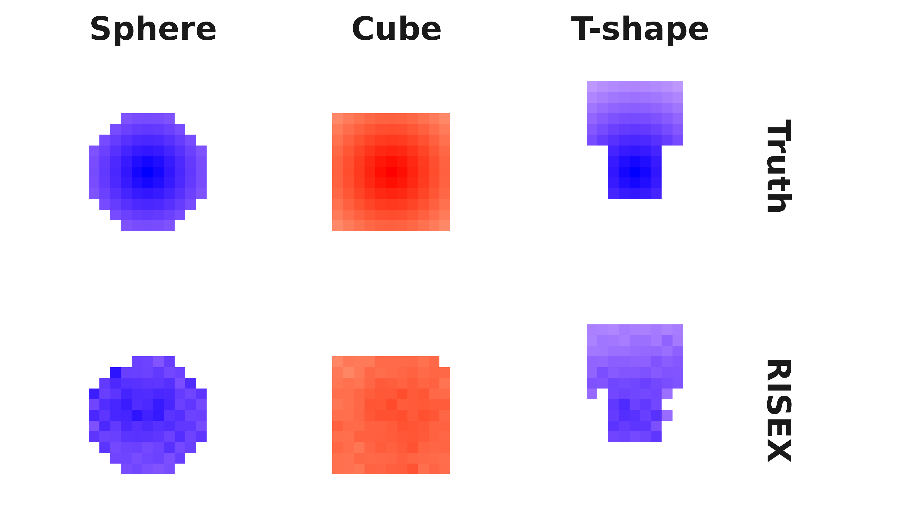

# RISE-X

This is the R package (RISEX) for "Robust Image-on-scalar Regression with Simultaneous Activation Region and Extreme Signal Detection".


## Installation

1. Download the anonymized repository as a ZIP file from:
   https://anonymous.4open.science/r/RISEX-C24D/

2. Extract the ZIP file.

3. Install the R package from the extracted directory:

```r
remotes::install_local("path/to/RISEX")
```

## Reproducible Workflow

```r
library(RISEX)
adj <- coordinates_to_adjacency_matrix.nf(voxels, connectivity = 6)
voxel_wise_fit <- voxel.wise.fit(img, cov_mat, voxels, cut_alpha = 0.95)
RISEX <- RISEX(img=img, voxels=voxels, cov_mat=cov_mat,
              voxel_wise_fit$psi_mat, voxel_wise_fit$lambda, adj = adj,
              beta0 = voxel_wise_fit$beta,
              sigma = voxel_wise_fit$sigma1,
              sigma0 = voxel_wise_fit$sigma0)
```

## Evaluation
```r
metrics(true_beta, RISEX$beta)
```


